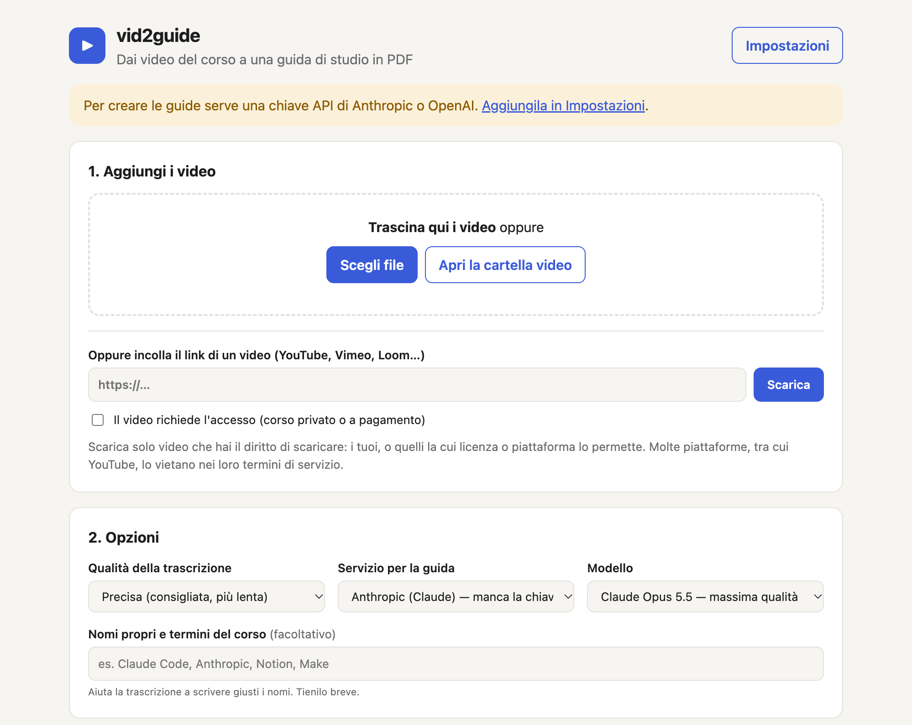
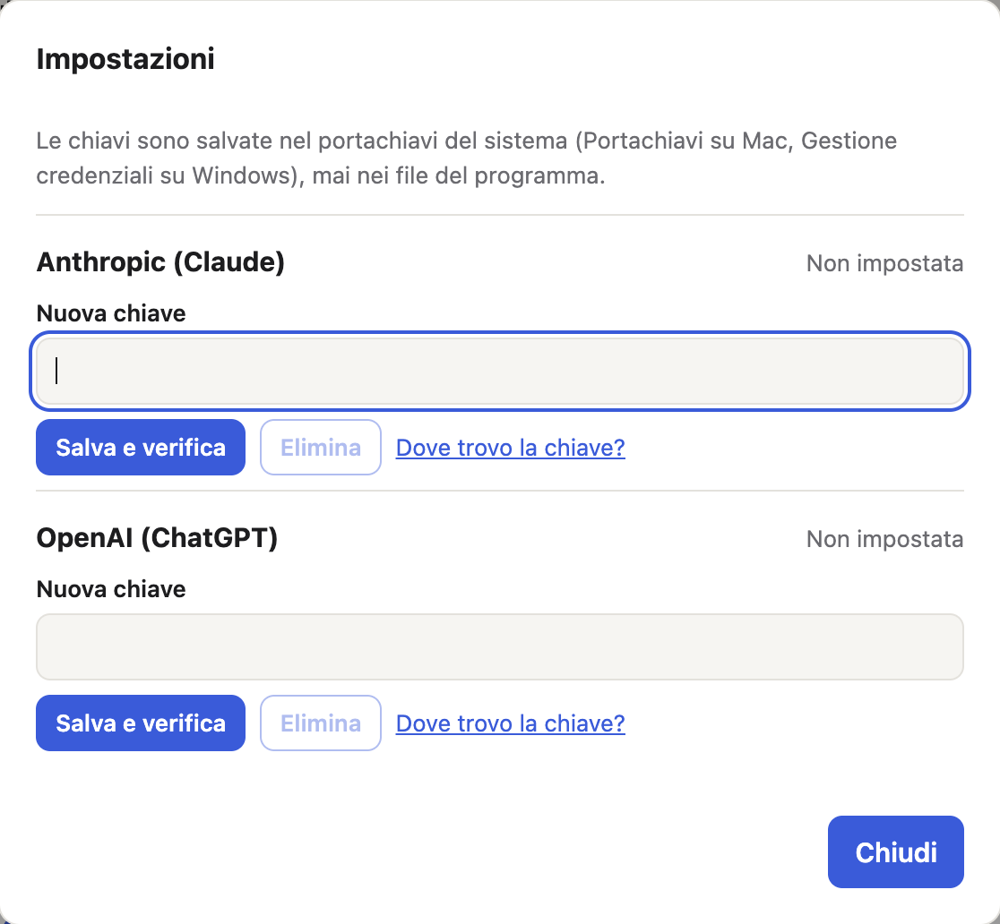
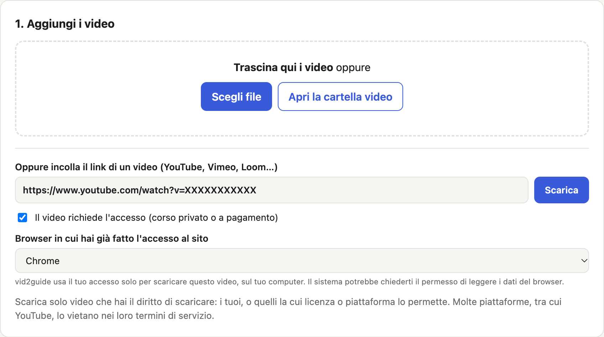
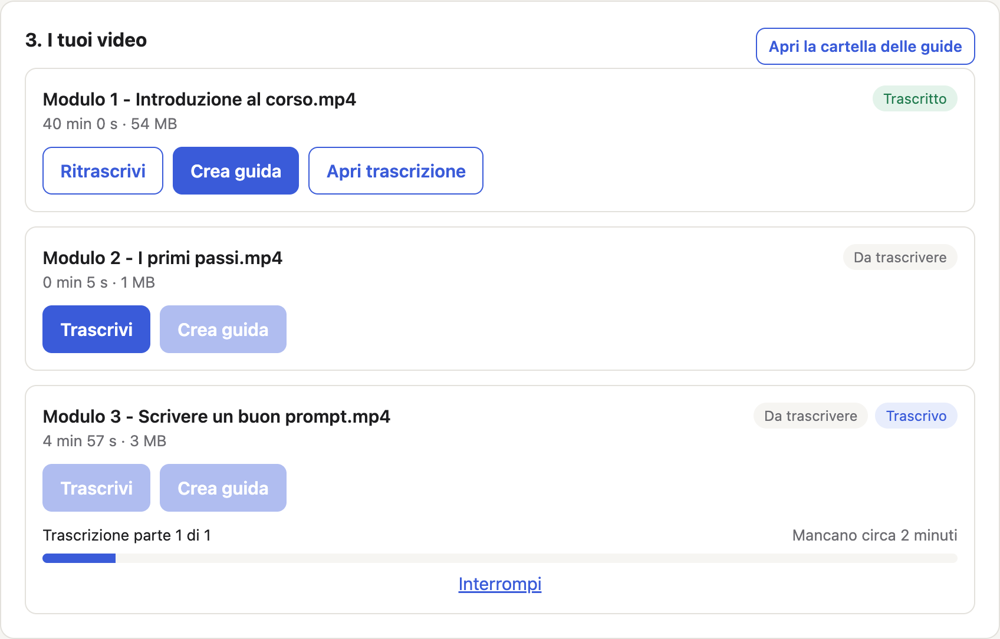

# vid2guide — Guida all'uso

**vid2guide** trasforma i video di un corso in una **guida di studio in PDF**. La guida contiene:

- un riassunto;
- l'indice degli argomenti, con il minuto esatto `[HH:MM:SS]` di ciascuno;
- i concetti spiegati dal docente;
- i prompt mostrati a schermo, con lo screenshot e il testo pronto da copiare.

Si usa dal browser, senza scrivere comandi.

> Questa è una **versione di prova**. Se qualcosa non funziona o non è chiaro, segnalalo: è
> proprio quello che ci serve sapere. Come: **[CANALE PER I FEEDBACK — DA DEFINIRE]**.

---

## Prima di iniziare

Ti servono:

- un **Mac** oppure un **PC con Windows 10 o 11**;
- circa **1,5 GB di spazio libero** per il programma. Servono poi altri ~4 GB ogni 14 ore
  di video, ma solo durante la trascrizione;
- **internet** per l'installazione e la prima trascrizione. La prima trascrizione scarica
  il modello che riconosce il parlato (~460 MB), e succede una volta sola;
- una **chiave API** di **Anthropic** (Claude) **oppure** di **OpenAI** (ChatGPT), con un
  po' di credito. Serve solo per creare le guide: la trascrizione è gratuita;
- **Chrome** o **Edge**, per il PDF. Edge c'è già su ogni Windows.

---

## 1. Installa vid2guide (una volta sola)

1. Scarica la cartella di vid2guide (dal link che hai ricevuto: **Code → Download ZIP**) e
   **decomprimila** dove vuoi tenerla, per esempio in Documenti.
2. Fai **doppio clic** sul file di installazione del tuo sistema:
    - **Mac** → `install-mac.command`
    - **Windows** → `install-windows.bat`
3. Si apre una finestra nera (il terminale) che installa tutto da sola. Ci vogliono alcuni
   minuti. Alla fine compare **«Installazione completata»**.

**Avvisi di sicurezza.** Il programma non è ancora «firmato», quindi la prima volta il
sistema chiede conferma:

- **Mac**: se compare «proviene da uno sviluppatore non identificato», fai **clic destro**
  sul file → **Apri** → **Apri**. Durante l'installazione il Mac può chiederti la
  password: è quella con cui accedi al computer.
- **Windows**: se compare «Windows ha protetto il PC», fai clic su **Ulteriori
  informazioni** → **Esegui comunque**.

Se l'installazione si ferma, nella cartella trovi il file `install.log`. Puoi rilanciare
l'installazione quando vuoi: salta i passi già fatti.

---

## 2. Apri vid2guide

Fai doppio clic su:

- **Mac** → `start-mac.command`
- **Windows** → `start-windows.bat`

Si apre di nuovo la finestra nera e, subito dopo, la pagina di vid2guide nel browser.

> **Lascia aperta la finestra nera** mentre usi vid2guide: è il programma che lavora.
> Quando hai finito, chiudila: vid2guide si chiude.

---

## 3. Inserisci la tua chiave API

La guida viene scritta da un'intelligenza artificiale, con la tua chiave: **paghi tu il
consumo**, direttamente ad Anthropic o a OpenAI, e solo per quello che usi.

1. Crea la chiave sul sito del servizio che preferisci, dopo aver aggiunto un po' di
   credito al tuo account:
    - Anthropic (Claude): <https://console.anthropic.com/settings/keys>
    - OpenAI (ChatGPT): <https://platform.openai.com/api-keys>
2. In vid2guide clicca **Impostazioni**, incolla la chiave e premi **Salva e verifica**.

vid2guide controlla che la chiave funzioni e la salva nel **portachiavi del computer**
(Portachiavi su Mac, Gestione credenziali su Windows). Non la scrive mai nei file del
programma e non la invia a nessuno, se non al servizio che hai scelto.

---

## 4. Aggiungi i video

Hai tre modi:

- **trascina** i file dei video nella pagina;
- usa **Scegli file**;
- usa **Apri la cartella video** e copiali lì.

Vanno bene i formati più comuni (`.mp4`, `.mov`, `.mkv`, `.webm`…).

**Oppure incolla un link** (YouTube, Vimeo, Loom e molti altri siti) e premi **Scarica**:
vid2guide scarica il video da solo e lo aggiunge all'elenco.

- **Corsi privati o a pagamento:** se il video si vede solo dopo l'accesso, spunta **«Il
  video richiede l'accesso»** e scegli il browser in cui sei già collegato a quel sito.
  vid2guide usa quell'accesso solo per scaricare il video, sul tuo computer. Il sistema può
  chiederti il permesso di leggere i dati del browser.
- **Se un sito non è supportato** (alcune piattaforme di corsi), spesso il video dentro la
  pagina è un video Loom o Vimeo: usa il link di quel video.

> **Scarica solo video che hai il diritto di scaricare**: i tuoi, oppure quelli la cui
> licenza o piattaforma lo permette. Molte piattaforme, YouTube compreso, lo vietano nei
> loro termini di servizio. La responsabilità è di chi usa il programma.

---

## 5. Trascrivi

Prima di premere **Trascrivi**, nella sezione **Opzioni** scegli:

- **Qualità della trascrizione**: **Precisa** è consigliata (scrive meglio nomi e termini
  tecnici, ma è più lenta); **Veloce** va bene per una prova.
- **Nomi propri e termini del corso** (facoltativo): scrivi i nomi di strumenti, persone e
  marchi che il docente cita (per esempio «Claude Code, Notion, Make»). Aiutano la
  trascrizione a scriverli giusti. Tieni l'elenco breve.

Poi premi **Trascrivi** accanto al video.

- La barra mostra l'avanzamento. Il **tempo rimanente** è calcolato sulla velocità reale
  del tuo computer, quindi diventa preciso dopo i primi minuti.
- La trascrizione avviene **sul tuo computer**: è gratuita e l'audio non viene inviato a
  nessuno.
- Una lezione lunga può richiedere parecchio tempo: puoi lasciarla lavorare. Se chiudi
  vid2guide o premi **Interrompi**, il lavoro fatto resta salvo. Rilanciando, riparte da dove
  si era fermato.

---

## 6. Crea la guida

Quando il video è **Trascritto**:

1. nelle **Opzioni** scegli il **servizio** (Anthropic o OpenAI) e il **modello**. Quello
   «più economico» costa circa la metà o meno, quello «massima qualità» scrive guide più
   accurate;
2. premi **Crea guida**;
3. vid2guide ti mostra il costo previsto per la lettura della trascrizione. Conferma con
   **Crea la guida**.

La guida richiede qualche minuto. Prima legge tutta la trascrizione, poi cerca e legge i
prompt mostrati a schermo. Alla fine vedi il **costo effettivo**, calcolato sui consumi reali.

**Quanto costa.** Due esempi misurati con Claude Sonnet 5.5 («più economico»):

| Video | Prompt a schermo | Costo |
|---|---|---|
| Registrazione di 29 minuti | nessuno | 0,11 $ |
| Lezione di 19 minuti | 7 | 0,20 $ |

Lezioni più lunghe o con più prompt costano di più. Con i modelli «massima qualità» il
costo è più alto: con Claude Opus 5.5, per esempio, è il doppio.

---

## 7. Apri e usa la guida

Premi **Apri PDF** accanto al video, oppure **Apri la cartella delle guide**. Il PDF ha il
nome della lezione. Nella stessa cartella c'è anche la versione modificabile (`.md`) con
le immagini.

La guida contiene:

- **In breve**: di cosa parla la lezione e a chi serve.
- **Indice cronologico**: gli argomenti in ordine, ognuno con il minuto esatto del video.
- **Concetti tecnici**: le spiegazioni del docente, con i minuti in cui ne parla.
- **Prompt e framework mostrati**: ogni prompt mostrato a schermo con il suo **screenshot**
  e il **testo da copiare**, e i procedimenti spiegati a voce.
- **Da verificare**: i punti in cui l'audio non era chiaro, con il minuto per riascoltarli.

**Quanto ti puoi fidare della guida.**

- Ogni minuto citato viene **controllato dal programma** sulla trascrizione. Quelli che
  non corrispondono a nessun punto vengono tolti, mai spostati a un minuto stimato, e la
  guida dice quanti ne ha tolti.
- Le parole che la trascrizione ha capito male sono segnalate come
  `[trascrizione incerta: …]`, non corrette in silenzio.
- Se un prompt è coperto (per esempio dalla webcam del docente) o illeggibile, la guida lo
  dice e lascia il minuto per guardarlo nel video.

---

## 8. Problemi frequenti

| Cosa vedi | Cosa fare |
|---|---|
| «Sessione non valida» nella pagina | Chiudi la pagina e riapri vid2guide con `start-mac.command` / `start-windows.bat`. |
| «Chiave … non valida» | Ricontrolla di averla copiata per intero, oppure creane una nuova. |
| «Credito … esaurito» | Ricarica il credito sul sito del servizio (Anthropic o OpenAI). |
| «Il video non contiene nessuna traccia audio» | Il file non ha audio: prova a riscaricarlo. |
| «Il video è privato o richiede l'accesso» | Spunta «Il video richiede l'accesso» e scegli il browser in cui sei collegato. |
| «Questo sito non è supportato» | Cerca il link del video vero e proprio (spesso Loom o Vimeo). |
| Un prompt «non compare nei fotogrammi» | Il docente lo mostra molto dopo averne parlato: usa il minuto indicato per vederlo nel video. |
| La trascrizione sembra ferma all'inizio | La prima volta scarica il modello (~460 MB): aspetta qualche minuto. |
| Manca il PDF ma c'è il file `.md` | Installa Chrome o Edge e premi «Rifai la guida». |

---

## 9. Privacy

- **Trascrizione**: avviene tutta sul tuo computer. L'audio non esce mai.
- **Guida**: per scriverla, il testo della trascrizione e alcuni fotogrammi del video
  vengono inviati al servizio che scegli (Anthropic o OpenAI), con la tua chiave. Se i tuoi
  video sono riservati, valuta se è accettabile.
- **Chiavi API**: restano nel portachiavi del tuo computer.
- I video, le trascrizioni e le guide restano nella cartella di vid2guide sul tuo computer.
